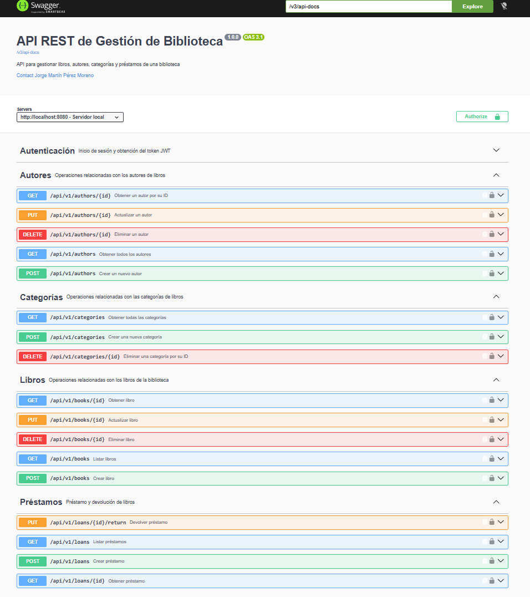
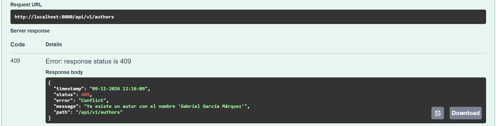
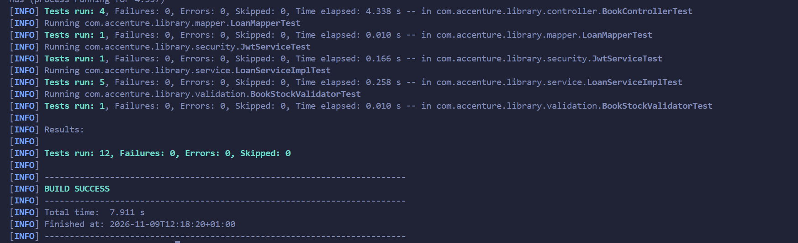

# Library Management API


API REST para gestionar los **libros, autores, categorías y préstamos** de una biblioteca, desarrollada con **Spring Boot**. Al prestar un libro se descuenta su stock y al devolverlo se repone, siempre de forma atómica.

Proyecto final del bootcamp **Back-End Java con GenAI** (Accenture · Universidad San Pablo CEU).

### Qué incluye

- Arquitectura **por capas** (Controller → Service → Repository) con DTOs (`record`) y mappers.
- **Spring Data JPA + MySQL**: relaciones `@ManyToOne` y `@ManyToMany`, consultas derivadas y JPQL con filtros opcionales.
- **Paginación, ordenación y filtros** en el listado de libros.
- **Bean Validation**, con dos validaciones personalizadas de clase.
- **Manejo global de errores** con una estructura de respuesta única para todos los códigos (400, 401, 403, 404, 405, 409, 500).
- **Seguridad stateless con JWT** y dos roles (ADMIN y USER).
- Documentación **OpenAPI / Swagger UI**.
- **Tests** con JUnit 5, Mockito y MockMvc.
- Imagen **Docker** multi-stage.

### Tecnologías

| Área | Tecnología |
|---|---|
| Lenguaje | Java 21 |
| Framework | Spring Boot 4.1.1 (Web MVC, Data JPA, Validation, Security) |
| Base de datos | MySQL 8 · H2 en memoria (perfil Docker) |
| Seguridad | Spring Security + JWT (jjwt, HS256) + BCrypt |
| Documentación | springdoc-openapi (Swagger UI) |
| Tests | JUnit 5, Mockito, MockMvc |
| Otros | Lombok (solo entidades), Maven, Docker |

### Capturas

**Documentación OpenAPI (Swagger UI)**: todos los endpoints, protegidos con JWT salvo el login.



**Regla de negocio**: crear un autor con el mismo nombre y apellidos que otro existente devuelve 409 con la estructura de error común.



**Tests**: 12 tests con JUnit 5, Mockito y MockMvc.



---

## Requisitos previos

| Herramienta | Versión |
|---|---|
| Java (JDK) | 21 |
| Maven | 3.9 o superior (también se puede usar el wrapper incluido, `./mvnw`) |
| MySQL | 8.0 o superior |

---

## Puesta en marcha desde cero

### 1. Crear la base de datos

El script `db/init.sql` crea la base de datos `library` si no existe, borra y recrea todas las tablas y carga los datos de prueba. Se puede ejecutar tantas veces como se quiera: siempre deja la base de datos en su estado inicial.

Desde la raíz del proyecto (donde está `pom.xml`):

```bash
mysql --default-character-set=utf8mb4 -u root -p < db/init.sql
```

También se puede abrir `db/init.sql` en MySQL Workbench (o en el cliente de base de datos de VS Code) y ejecutarlo completo.

### 2. Configurar las credenciales (variables de entorno)

Las credenciales **no están en el código**: se leen de variables de entorno. Los valores entre paréntesis son los que se usan si la variable no está definida.

| Variable | Para qué | Por defecto |
|---|---|---|
| `DB_PASSWORD` | Contraseña de MySQL | *(vacía)* |
| `DB_USERNAME` | Usuario de MySQL | `root` |
| `DB_URL` | URL de conexión | `jdbc:mysql://localhost:3306/library` |
| `JWT_SECRET` | Clave de firma de los tokens (mínimo 32 caracteres) | clave de desarrollo, **no usar en producción** |

Normalmente basta con definir la contraseña de MySQL en la terminal antes de arrancar:

```powershell
# PowerShell (Windows)
$env:DB_PASSWORD="tu_contraseña"
```

```bash
# Bash (Linux / macOS / Git Bash)
export DB_PASSWORD=tu_contraseña
```

La variable solo dura mientras la terminal está abierta.

### 3. Arrancar la aplicación

```bash
./mvnw spring-boot:run
```

La API queda disponible en `http://localhost:8080`.

### 4. Ejecutar los tests

```bash
./mvnw test
```

Los tests no necesitan MySQL ni ningún servicio externo.

---

## Documentación de la API (Swagger UI)

**http://localhost:8080/swagger-ui.html**

Para probar los endpoints protegidos:
1. Ejecutar `POST /auth/login` con uno de los usuarios de la tabla siguiente.
2. Copiar el `token` de la respuesta.
3. Pulsar **Authorize** y pegar el token.

---

## Usuarios de la API

| Usuario | Contraseña | Rol | Permisos |
|---|---|---|---|
| `admin` | `admin123` | ADMIN | Todos los endpoints |
| `user` | `user123` | USER | Todos excepto los `DELETE` de libros, autores y categorías (403) |

Las credenciales están definidas en el código (`SecurityConfig`), marcadas con un `TODO`: en producción deben venir de base de datos.

---

## Endpoints

Todos requieren el token en la cabecera `Authorization: Bearer <token>`, salvo `POST /auth/login`.

| Método | URL | Descripción |
|---|---|---|
| POST | `/auth/login` | Iniciar sesión y obtener el token JWT (público) |
| GET | `/api/v1/books` | Listar libros (paginado, ordenado y filtrado) |
| GET | `/api/v1/books/{id}` | Obtener un libro |
| POST | `/api/v1/books` | Crear un libro |
| PUT | `/api/v1/books/{id}` | Actualizar un libro |
| DELETE | `/api/v1/books/{id}` | Eliminar un libro (solo ADMIN) |
| GET | `/api/v1/authors` | Listar autores |
| GET | `/api/v1/authors/{id}` | Obtener un autor |
| POST | `/api/v1/authors` | Crear un autor |
| PUT | `/api/v1/authors/{id}` | Actualizar un autor |
| DELETE | `/api/v1/authors/{id}` | Eliminar un autor (solo ADMIN) |
| GET | `/api/v1/categories` | Listar categorías |
| POST | `/api/v1/categories` | Crear una categoría |
| DELETE | `/api/v1/categories/{id}` | Eliminar una categoría (solo ADMIN) |
| GET | `/api/v1/loans` | Listar préstamos |
| GET | `/api/v1/loans/{id}` | Obtener un préstamo |
| POST | `/api/v1/loans` | Crear un préstamo |
| PUT | `/api/v1/loans/{id}/return` | Devolver un libro |

### Parámetros de `GET /api/v1/books`

| Parámetro | Descripción | Por defecto |
|---|---|---|
| `page` | Número de página, desde 0 | 0 |
| `size` | Elementos por página (máximo 100) | 20 |
| `sort` | `campo` o `campo,dirección`. Campos: `title`, `isbn`, `publishedYear`, `availableStock`, `totalStock` | `title,asc` |
| `categoryId` | Solo libros de esa categoría | — |
| `authorId` | Solo libros de ese autor | — |
| `available` | `true`: con stock disponible; `false`: sin stock | — |

Se han implementado los **tres filtros**, que se combinan entre sí y con la paginación.

---

## Decisiones técnicas

**Arquitectura.** Aplicación **monolítica por capas**: un único proyecto que se despliega como un solo `.jar` contra una única base de datos, organizado internamente en Controller → Service (interfaz + implementación) → Repository, con DTOs para la entrada y la salida y Mappers manuales en clases separadas. Los controllers no contienen lógica de negocio ni capturan excepciones. Para el tamaño de este dominio (cuatro entidades muy relacionadas entre sí), un monolito es más simple de desarrollar, probar y desplegar que una arquitectura de microservicios.

**Relaciones JPA**
- **Unidireccionales**, navegando desde la entidad que tiene la clave foránea: `Book → Category`, `Book → Author` y `Loan → Book`. `Category` y `Author` no tienen colección de libros. Las comprobaciones inversas ("¿tiene libros?") se hacen con consultas del repositorio (`existsByCategoryId`, `existsByAuthorsId`). Así el modelo es más simple, se evita la recursión infinita al convertir a JSON y no se cargan colecciones que no se usan. Los libros de una categoría o de un autor se obtienen con `GET /api/v1/books?categoryId=X` o `?authorId=X`, de forma paginada.
- **`Book` es la propietaria del `@ManyToMany`** con `Author` (lleva el `@JoinTable book_author`), porque los autores se asignan al crear o editar un libro mediante `authorIds`.
- **`FetchType.LAZY`** en todas las relaciones: `@ManyToOne` es EAGER por defecto y se ha cambiado para no cargar datos que no se necesitan. Las relaciones se cargan dentro de las transacciones del Service, donde se hace la conversión a DTO (`spring.jpa.open-in-view=false`).
- Los autores de un libro se guardan en un **`Set`**: no admite duplicados, por lo que `authorIds` con ids repetidos asocia cada autor una sola vez.
- **Sin `cascade`** en ninguna relación, como exige el enunciado.
- `ddl-auto=validate`: Hibernate solo comprueba que las entidades coinciden con el esquema creado por `db/init.sql`.

**Préstamos**
- El estado **OVERDUE** no se guarda nunca: lo calcula `LoanMapper` al construir la respuesta (préstamo ACTIVE con `expectedReturnDate` anterior a hoy). Se calcula en una variable local para no modificar la entidad y que Hibernate no lo persista.
- La creación y la devolución de un préstamo son **atómicas** gracias a `@Transactional`: si algo falla, se deshacen tanto el préstamo como el cambio de stock.

**Validaciones**
- Bean Validation en los DTO de entrada, con mensajes en español centralizados en la clase `ValidationMessages`.
- Dos validaciones de clase personalizadas (`@ValidBookStock` y `@ValidLoanDates`) para las reglas que dependen de dos campos. Si alguno de los campos es nulo, la regla no se evalúa.

**Errores**
- `GlobalExceptionHandler` (`@RestControllerAdvice`) centraliza todos los errores con la misma estructura (`ErrorResponseDTO`) y fuerza la respuesta a JSON, también en el 406.
- Los textos de error están en la clase `ErrorMessages`; los que llevan datos (un id, un ISBN…) son plantillas que se completan con `String.formatted()`.
- Excepciones propias con nombres descriptivos: `ResourceNotFoundException` (404), `ReferencedResourceNotFoundException` (400, id inexistente en el body), `InvalidQueryParameterException` (400, paginación u ordenación no válidas), `DuplicateResourceException`, `ResourceInUseException`, `BookOutOfStockException` y `LoanAlreadyReturnedException` (409).
- Se respeta el orden de prioridad del enunciado: 401 → 403 → 400 → 404 → 409.
- Cualquier violación de una restricción de la base de datos (`DataIntegrityViolationException`) devuelve 409.
- No se permiten duplicados: un **ISBN** repetido, una **categoría** con el mismo nombre o un **autor** con el mismo nombre y apellidos (sin distinguir mayúsculas) devuelven 409. La nacionalidad no forma parte del criterio porque es opcional: si contara, bastaría con omitirla para crear un duplicado.

**Paginación y ordenación.** Se validan manualmente en el Service. El parámetro `sort` se lee tal como llega en la petición (`getParameterValues`) para poder detectar si viene repetido. Siempre se desempata por `id` ascendente. El filtro por autor usa una subconsulta `EXISTS` para que cada libro aparezca una sola vez y la paginación sea correcta.

**Seguridad**
- Autenticación **stateless** con JWT firmado con **HS256**. El token incluye `sub`, `role`, `iat` y `exp` y caduca a las 24 horas. La clave secreta se lee de la variable de entorno `JWT_SECRET`.
- El rol que se guarda en el token es la autoridad que empieza por `ROLE_`, no `FACTOR_PASSWORD`.
- Los `DELETE` usan el patrón `/api/v1/books/*` (un solo nivel): así `DELETE /api/v1/books` sin id y `DELETE /api/v1/loans/{id}` devuelven 405 para cualquier rol.
- Los errores 401 y 403 se producen en los filtros de seguridad; el *entry point* y el *access denied handler* los reenvían al `HandlerExceptionResolver` para que el `GlobalExceptionHandler` los devuelva con la estructura de error estándar.
- CORS configurado para el frontal de prueba (solo para desarrollo).

**Código.** Sin lambdas ni Stream API en `src/main`, salvo en la configuración de seguridad (permitido por el enunciado). Javadoc en todas las clases y métodos de `src/main`.

---

## Extras y cambios respecto al enunciado

- **Lombok** (`@Getter`, `@Setter` y `@NoArgsConstructor`), solo en las entidades JPA, para reducir el código repetitivo. No se usa `@Data` porque el `equals`, el `hashCode` y el `toString` que genera dan problemas con JPA (id nulo antes de guardar, carga LAZY y recursión).
- **DTOs como `record`** de Java: inmutables y concisos.
- **`ErrorResponseDTO`**: la respuesta de error se nombra con el sufijo `ResponseDTO` para seguir la convención de nombres de los DTO del enunciado.
- **`PageResponseDTO<T>`** genérico para la respuesta paginada, con los campos exactos del enunciado.
- Se han implementado **los tres filtros** de libros (`categoryId`, `authorId` y `available`); el enunciado pide al menos uno.

---

## Docker (requisito opcional)

La imagen se construye con un `Dockerfile` multi-stage (Maven con Java 21 para compilar y `eclipse-temurin:21-jre-alpine` para ejecutar). Dentro del contenedor se activa el perfil `docker` (`application-docker.properties`), que sustituye MySQL por una base de datos **H2 en memoria** con `ddl-auto=create-drop`. El script `db/init.sql` no se usa en este perfil, así que la base de datos arranca vacía. Fuera del contenedor, la aplicación sigue funcionando con MySQL.

Desde la raíz del proyecto:

```bash
docker build -t library:1.0 .
docker run -p 8080:8080 library:1.0
```

Para comprobarlo en Swagger UI (`http://localhost:8080/swagger-ui.html`): hacer login con `POST /auth/login`, autorizar con el token, crear una categoría con `POST /api/v1/categories` y listarla con `GET /api/v1/categories`.

---

## Tests

12 tests con JUnit 5, Mockito y MockMvc, con el patrón Given / When / Then:

| Clase | Tests | Casos del enunciado |
|---|---|---|
| `LoanServiceImplTest` | 5 | 1, 2, 3 (stock y estado) y 4 |
| `BookControllerTest` | 4 | 5, 6, un 200 y 10 (403 con la seguridad real) |
| `LoanMapperTest` | 1 | 7 |
| `BookStockValidatorTest` | 1 | 8 |
| `JwtServiceTest` | 1 | 9 |

---

## Mejoras futuras

- **Internacionalización**: los mensajes ya están centralizados en clases de constantes (`ValidationMessages` y `ErrorMessages`); el siguiente paso sería moverlos a `messages.properties` con `MessageSource` para ofrecerlos en varios idiomas.
- **Usuarios en base de datos**: sustituir los usuarios en memoria por una tabla y un `UserDetailsService` propio.
- **Docker Compose**: levantar también un contenedor de MySQL para que los datos persistan.
- **Organización por funcionalidad**: agrupar el código por dominio (`book`, `loan`…) en lugar de por capa.
- **Migraciones versionadas** del esquema con Flyway.

---

## Autor

**Jorge Martín Pérez Moreno** · Desarrollador Software Junior

- LinkedIn: [jorge-martin-perez-moreno](https://www.linkedin.com/in/jorge-martin-perez-moreno)
- Portfolio: [jorge-martin-dev.netlify.app](https://jorge-martin-dev.netlify.app/)
- Email: jorgemartinpm@gmail.com
